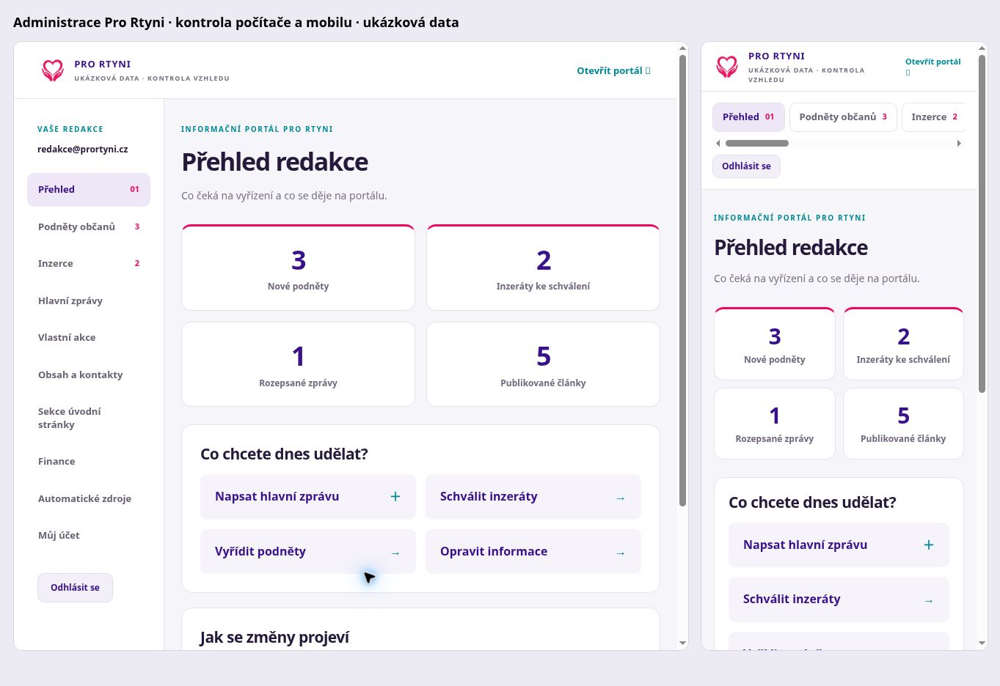

# Redakční systém Pro Rtyni

Administrace: https://prortyni.cz/admin/ . Redakční účet používá schránku redakce@prortyni.cz. Přístup se ověřuje na serveru proti členství v redakci tohoto portálu, nikoli podle přihlášení k jinému webu ve stejném Supabase projektu.

## Co lze spravovat

- Nástěnka: nové podněty, čekající inzeráty, koncepty a publikované články.
- Podněty: hledání, stavy, kontakty pro odpověď, soukromé interní poznámky.
- Inzerce: kontrola textu a fotografií, schválení, zamítnutí, stažení a poznámka pro inzerenta. Soukromé inzeráty mají platnost 30 dní.
- Hlavní zprávy: koncepty, publikace, stažení do konceptu, autor, datum, zdroje, hlavní body, formátování a náhled.
- Vlastní akce: datum, čas, místo, popis, zdroj a publikace přímo do kalendáře.
- Obsah a kontakty: vyhledání a opravy převzatých praktických informací, spolků, akcí, místních zpráv a rozhlasu. Ruční opravy mají přednost před importem. Původní zdroj se zachovává. Lze skrýt záznam a vrátit automatický obsah. Při nahrazení textu detailu zůstávají dokumenty zachované.
- Sekce: vlastní nadpis, doplňující úvodní text a viditelnost 14 sekcí úvodní stránky. Nejde o editor libovolného HTML, změnu navigace nebo algoritmů počasí/odjezdů.
- Finance: koncepty a publikované záznamy s částkou, rokem, vysvětlením a zdrojem.
- Zdroje: přehled úspěšnosti importů a ruční spuštění aktualizace.
- Účet: odhlášení a změna hesla. Obnova redakčního účtu používá vlastní jednorázový odkaz přímo na portál; globální Auth Site URL, SMTP ani šablony jiných webů se nemění.

## Integrita a bezpečnost

Změny článků, akcí, financí, oprav a sekcí se zapisují do neveřejné historie. Předchozí podobu lze načíst do formuláře ke kontrole a znovu uložit. Optimistická kontrola revize odmítá přepsání záznamu, který mezitím změnil jiný editor. Texty se vykreslují bezpečně; klient nedostává serverové klíče. Neveřejné tabulky mají RLS a žádná oprávnění pro veřejné role. Reset hesla má pevnou redakční adresu a limit jedné žádosti za pět minut.

Živý seznam článků má přednost před statickou zálohou i při prázdném výsledku. Při výpadku živého spojení může portál použít poslední uloženou kopii; změny vyžadují obnovení stránky. Importovaná data nejsou přepisována v původních tabulkách: opravy jsou samostatná vrstva.

## Ověření

- Celá sada `npm test` a `node scripts/test_admin_recovery.mjs`.
- Skutečné API: nepřihlášený požadavek 401, přihlášený účet bez místní role 403, redaktor 200. Vložení a úprava neveřejných článků, akcí i financí 200, souběžná změna 409, oprava a návrat původního obsahu 200. Testovací účty a data byly odstraněny.
- Prohlížeč: přihlášení, editor a bezpečný náhled formátování; počítač a mobil 390 px bez přetečení stránky. Přehled při vizuální kontrole používá výslovně označená ukázková data.
- Přihlášení vlastníka a volbu jeho skutečného hesla dokončí vlastník z e-mailu; heslo není součástí repozitáře ani tohoto dokumentu.

