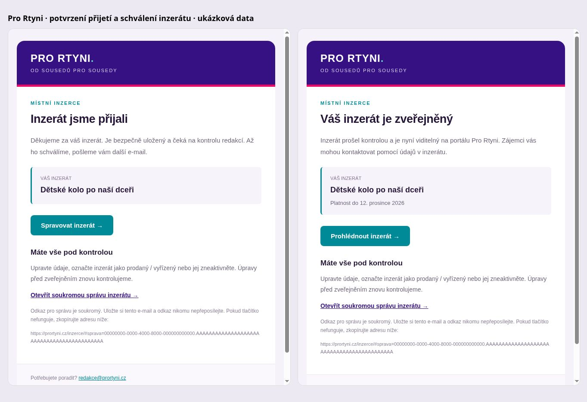
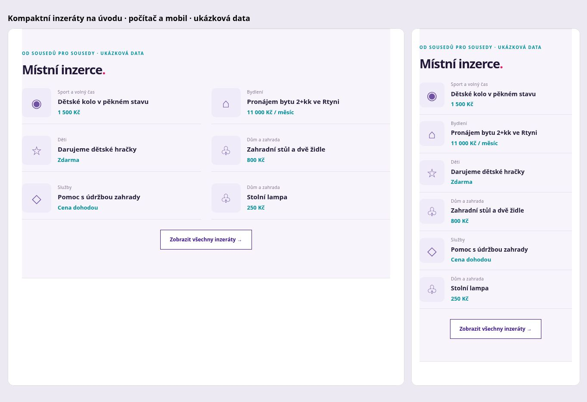

# Potvrzení inzerentům a kompaktní přehled

## Aktivace

V administraci otevřete **E-maily inzerentům** a zadejte heslo schránky redakce@prortyni.cz nebo heslo pro poštovní aplikace Seznamu. Připojení je pevně omezené na smtp.seznam.cz:465 s ověřeným TLS. Nejprve se odešle zkušební zpráva do redakční schránky. Teprve po úspěšném předání se heslo uloží do projektového šifrovaného Vaultu a zapne minutový dispatcher. Heslo se klientovi nikdy nevrací. Nastavení sdíleného Supabase Auth SMTP se nemění.

Bez tohoto kroku jsou nové zprávy uložené ve frontě, nikoli odeslané. Aktuální implementace nepoužívá Cloudflare Email Routing pro zasílání libovolným inzerentům; jeho starý pevný příjemce zůstává určený pro redakční upozornění.

## Inzerent

Provozní zprávy: přijetí, úprava, schválení, zamítnutí, zneaktivnění, vyřízení, konec platnosti a opětovné zaslání odkazu. Obsahují HTML v barvách portálu i textovou alternativu. Soukromý odkaz umožňuje správu bez registrace. Klíč zůstává ve fragmentu URL a generuje se z původního požadavku; v databázi inzerátů je uložený jen jeho hash. Fotografie a kontakty nejsou vložené do e-mailových náhledů.

Označení **Prodané / vyřízené** nebo **Neaktivní** stáhne inzerát z veřejné nabídky. Úpravou se znovu vrátí do schvalování. Prodaný stav používá doplňující sloupec completion_state; původní databázový status withdrawn zůstává zachovaný.

## Redakce a spolehlivost

Fronta se plní atomicky databázovým triggerem při uložení. Duplicitní stejný přechod stavu nevytváří další potvrzení. Odesílání používá pracovní zámek, časový limit, opakování nejvýše pěti pokusů a stabilní Message-ID. Úspěch znamená přijetí SMTP serverem, nikoli potvrzenou doručenou schránku nebo přečtení. Změněné adresy a překonaná schválení se neodesílají. Odkazy již existujícím inzerentům lze zařadit jednotlivě tlačítkem **Poslat inzerentovi odkaz pro správu**; historické zprávy se hromadně neposílají.

Veřejnost nemá přístup k frontě ani nastavení. Přístup ke konfiguraci a přehledu vyžaduje ověřené přihlášení a místní správcovskou roli. Změny byly aplikované jako pojmenovaná aditivní migrace bez výměny původních stavových omezení, mazání dat nebo automatického zapnutí odesílání.

## Úvod a navigace

Úvodní stránka zobrazuje nejvýše šest kompaktních náhledů: miniatura, rubrika, název, cena. Plné karty zůstávají v Inzerci a Bydlení. Odkaz Hlavní zprávy ve všech čtyřech hlavičkách vede přímo na /zpravy/.

## Kontroly

- Celá sada npm test a test obnovy administrace.
- Rollback databázový test přijetí, schválení, opakovaného schválení bez duplicit, prodáno, neaktivní, úprava. Žádné testovací e-maily nebyly odeslané.
- SMTP test s izolovaným transportem: pevný TLS server, části zápisů, víceřádkové odpovědi, chyba přihlášení, uzavření spojení, obrana proti vložení SMTP příkazů.
- HTML/text, escapování textů, bezpečné URL, mobilní náhled bez přetečení.
- Skutečnou SMTP autentizaci a doručení lze dokončit až po připojení schránky vlastníkem v administraci.

